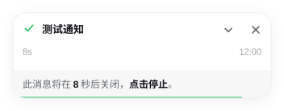
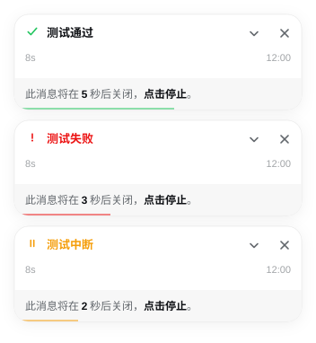

一个 DeepSeek Harness 的会话通知插件：每轮回复结束时，在输入框正上方弹出一张轻量卡片并播放提示音。卡片默认收起，可展开查看摘要，底部倒计时条显示剩余时间，点击可停止自动关闭。完成、失败、中断使用不同的颜色与图标，失败时正文直接显示错误信息。通知只在 DSH 页面内显示，不使用系统通知。

## 功能

- 触发：会话完成一轮回复时，在输入框上方弹出通知卡片。
- 定位：右侧与输入框对齐，跟随输入框的位置和高度变化。
- 摘要：默认收起，点右侧箭头展开查看完整摘要，再点收起，摘要中的粗体、行内代码、斜体、链接会正常渲染。
- 倒计时：卡片底部显示剩余秒数，绿色进度条同步缩短，9 秒后自动关闭。
- 停止：点击倒计时条停止自动关闭，倒计时条折叠消失，之后只能手动关闭。
- 状态：完成、失败、中断使用不同的颜色与图标，失败时正文直接显示错误信息。
- 声音：完成时播放提示音，失败音色不同，音量可调，0 为静音。
- 外观：圆角、边框、阴影与输入框一致，宽度、高度和间距可调，跟随亮 / 暗主题。
- 免打扰：支持每日时段，时段内不弹通知。
- 测试：设置页可发送测试通知，立即预览卡片和声音。
- 操作：点击卡片切换到对应会话，同一时间最多显示 4 张。

## 安装

纯 JavaScript 编写，无第三方依赖，无构建步骤。要求 DSH 0.2 以上。

- 桌面端：设置 → 插件，填入 `github:waddlechef/dsh-session-toast`。安装后通常立即生效，未生效则重启 DSH 并 `Ctrl+R` 刷新页面。
- 网页端：`dsh plugin --profile <profile> add github:waddlechef/dsh-session-toast`

## 卸载

- 桌面端：设置 → 插件 中移除。
- 网页端：`dsh plugin --profile <profile> remove dsh-session-toast`

## 使用

安装后无需额外配置，每轮回复结束时会自动弹出卡片。卡片默认收起，只显示标题、耗时 / 时间和倒计时条。点右侧箭头展开摘要。倒计时条显示剩余秒数，点击后停止自动关闭并折叠该条。点击卡片切换到对应会话。

## 设置

设置 → 会话通知。

| 设置项    | 默认值           | 说明                          |
| ------ | ------------- | --------------------------- |
| 启用通知  | 开             | 总开关                         |
| 默认收起摘要 | 开             | 开启时摘要默认收起，关闭时默认展开         |
| 显示倒计时条 | 开             | 关闭后不显示倒计时条，通知仍会自动关闭       |
| 提示音    | 开             | 完成与失败使用不同音色                 |
| 音量     | 100%          | 范围 0–200，0 为静音，100 为默认响度   |
| 通知宽度   | 380 px        | 范围 240–720                  |
| 通知高度   | 140 px        | 范围 48–320，展开时的高度           |
| 底部间距   | 16 px         | 与输入框顶部的距离，范围 0–240，0 为紧贴输入框顶部 |
| 免打扰    | 关，22:00–08:00 | 时段内不弹通知                     |
| 默认值    | —             | 保存当前配置为默认 / 恢复默认           |
| 测试通知   | —             | 立即发送一张示例卡片                  |

## License

[MIT](./LICENSE)
